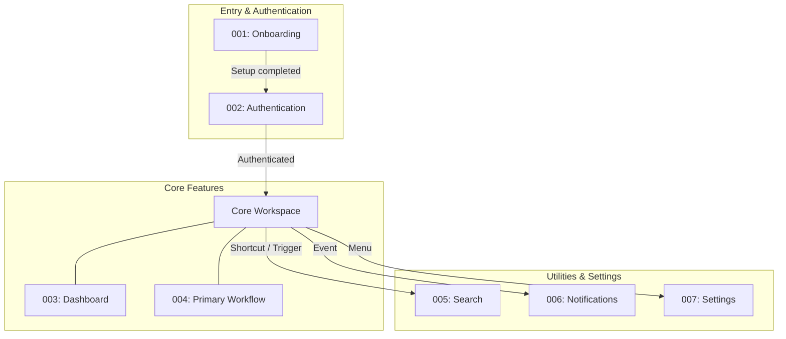

<!-- markdownlint-disable MD033 -->

# Feature List

Specifications, interaction flows, and implementation notes for project features are documented here.

## User flow architecture

The diagram below maps how users move through the system, from entry points to core workflows and utilities. Replace the example nodes and edges with your project's actual features:

## Features

| ID  | Date       | Feature                     | Status       |
| :-- | :--------- | :-------------------------- | :----------- |
| 000 | 2026-10-18 | [Template](000-template.md) | **Accepted** |

<!--
Example rows when adding project features:
| 001 | 2026-10-18 - | [Onboarding](001-onboarding.md) | Proposed |
| 002 | 2026-10-18 - | [Authentication](002-authentication.md) | Proposed |
-->

## Legend

- **Planned**: template of a feature record before project-specific changes;
- **Proposed**: the feature is under discussion and has not been approved yet;
- **Accepted**: the feature is approved and scheduled or actively being built;
- **Developed**: the feature is built and in active use;
- **Rejected**: the feature was considered but decided against;
- **Deprecated**: the feature was once in use but is no longer supported or recommended.