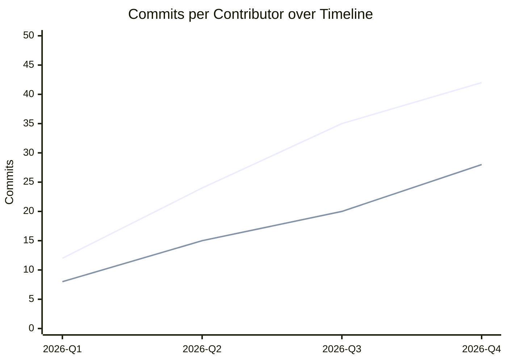
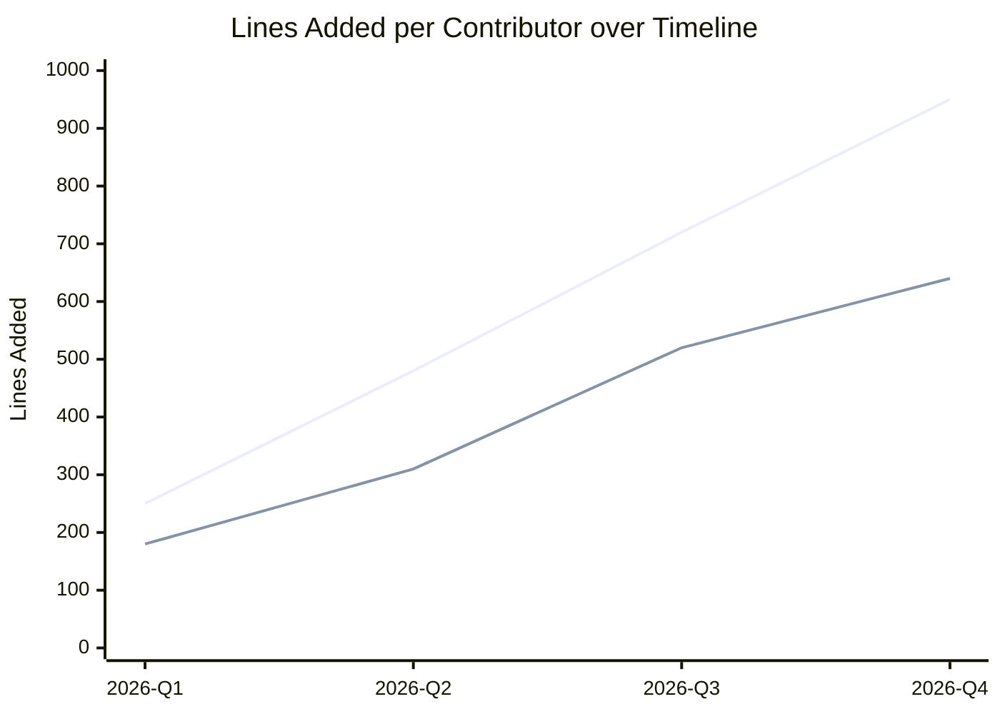
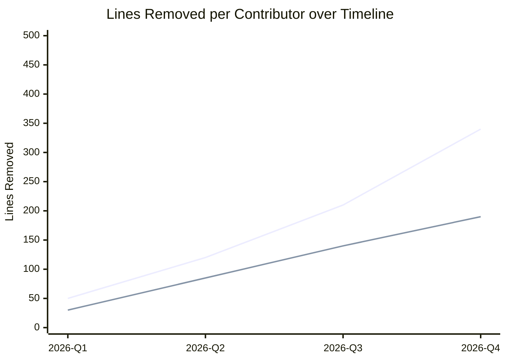
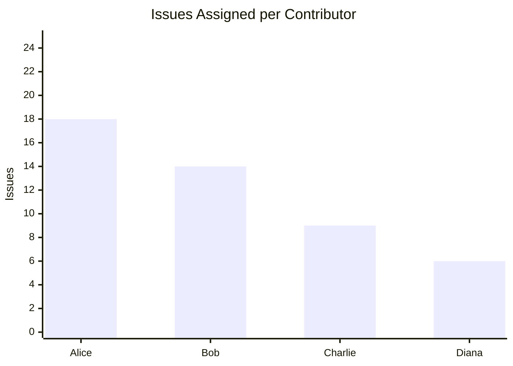

<!-- markdownlint-disable MD033 -->

# Project Measurement and Metrics

Software measurement connects project activities to objective decision-making. Following the Practical Software Measurement (PSM) framework and ISO/IEC 15939 measurement process, this page provides a quantitative view of development progress, code stability, and workload distribution.

## Measurement Scope and Filters

Configure the observation window and tracked authors for this project:

- **Start Date:** 2026-01-01
- **End Date:** Current (HEAD)
- **Tracked Contributors:** Contributor usernames mapped to distinct visual identifiers

## Code Activity and Churn

These measures track development cadence and code volume changes across the project timeline.

### Commit Velocity

Measures the number of commits submitted by each contributor across successive milestones or time intervals.

Placeholder chart: replace with project-specific commit series per contributor.

### Code Additions

Measures the volume of new lines introduced by each author over the observation period. Spikes in additions often coincide with initial feature scaffolding.

Placeholder chart: replace with lines added per contributor extracted from version control.

### Code Deletions

Measures lines removed by each author. Consistent deletions alongside additions indicate refactoring and technical debt reduction rather than pure accretion.

Placeholder chart: replace with lines deleted per contributor extracted from version control.

## Workload and Responsibility

This section monitors task distribution across contributors to ensure balanced ownership and prevent single points of failure.

### Assigned Issues by Contributor

Measures the quantity of tasks or issue tickets assigned to each team member.

Placeholder chart: replace with active or closed issue counts per contributor.

## Automation Strategy

These metrics are structured for automated generation:

1. **Git Data Extraction:** A Python script can parse `git log --numstat` between the configured start and end dates, calculating commit counts and line diffs per author.
2. **Deterministic Styling:** Each contributor username maps to a deterministic hex color, ensuring visual consistency across all charts.
3. **CI Pipeline Integration:** The extraction script can run during automated documentation builds or on git commit hooks, keeping the Mermaid charts or rendered SVG artifacts up to date without manual editing.

